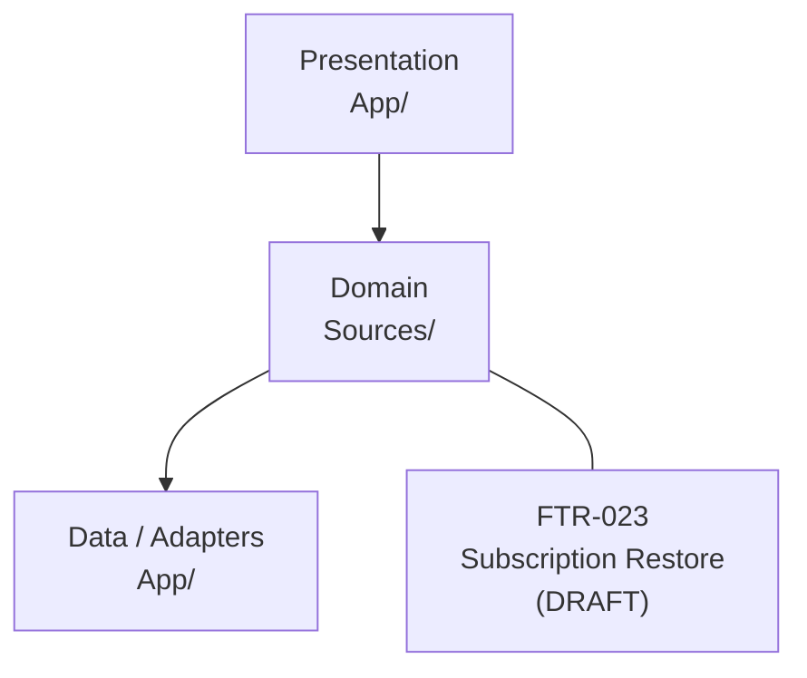
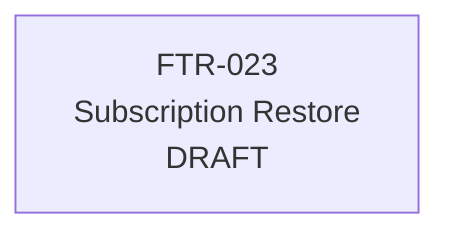

# Project Feature Map

> Generated by `scripts/sdd-feature-map` from `.sdd/feature-map.yaml`.

<!-- sdd-feature-map:start -->

## Architecture (from project)

```text
# Architecture
## Architecture Style
TBD
## Layers / Modules
Presentation → Domain → Data
## Dependency Rules
- Presentation must not instantiate infrastructure implementations directly.
- Domain must not depend on UIKit or external SDKs unless explicitly approved.
- Use protocols at architectural boundaries where substitution/testing is required.
## Exception Process
Architecture exceptions require a documented rationale and ADR where appropriate.
```

## Layer map



## Feature dependency graph



## Feature correlation table

| Feature | Status | Primary layer | Modules | Depends on | Related to | Provides | Consumes | Progress |
| --- | --- | --- | --- | --- | --- | --- | --- | --- |
| [FTR-023](features/FTR-023-subscription-restore/spec.md) Subscription Restore | `DRAFT` | `domain` | `RestorePurchasesView`, `SubscriptionViewModel`, `SubscriptionRepository`, `StoreKitRestoreAdapter` | — | — | subscription-access | — | req 0/0; plan 0/0 |

## How to maintain this

1. Edit `.sdd/feature-map.yaml` when a feature is created or its relationships change.
2. Record hard prerequisites in `depends_on`, soft links in `related_to`, shared code in `shares_modules_with`.
3. Use `provides` / `consumes` for capability contracts between features.
4. Run `make feature-map` (and commit the regenerated `.sdd/feature-map.md`).

<!-- sdd-feature-map:end -->
