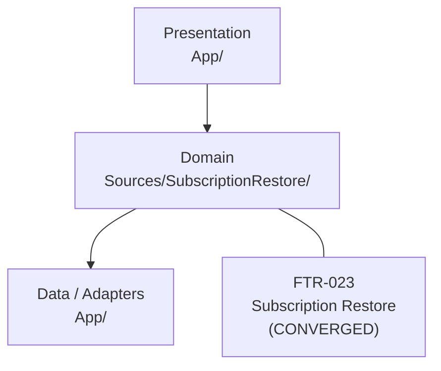
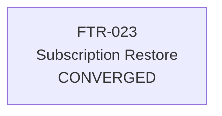

# Project Feature Map

> Generated by `scripts/sdd-feature-map` from `.sdd/feature-map.yaml`.

<!-- sdd-feature-map:start -->

### Architecture (from project)

```text
# Architecture
## Architecture Style
A thin SwiftUI screen calls a main-actor view model. The view model calls `SubscriptionRepository`. The repository talks only to `SubscriptionRestoring`. The app supplies `StoreKitRestoreAdapter` as that dependency.
RestorePurchasesView
        ↓
SubscriptionViewModel
        ↓
SubscriptionRepository
        ↓
SubscriptionRestoring
        ↓
StoreKitRestoreAdapter   (app target only)
        ↓
StoreKit 2
## Layers / Modules
Presentation (App/) → Domain (Sources/SubscriptionRestore/) → StoreKit adapter (App/)
`Sources/SubscriptionRestore/` is the domain library used by unit tests. It must not import SwiftUI or StoreKit.
## Dependency Rules
- Views do not call StoreKit.
- The view model does not call StoreKit.
- Entitlement decisions go through `EntitlementMapping`, which takes a snapshot and returns `SubscriptionAccess`.
- Tests substitute `SubscriptionRestoring`. They do not subclass the adapter.
## Exception Process
An exception to the StoreKit boundary requires an ADR. This sample's decision is `ADR-001`.
```

### Layer map



### Feature dependency graph



### Feature correlation table

| Feature | Status | Primary layer | Modules | Depends on | Related to | Provides | Consumes | Progress |
| --- | --- | --- | --- | --- | --- | --- | --- | --- |
| [FTR-023](features/FTR-023-subscription-restore/spec.md) Subscription Restore | `CONVERGED` | `domain` | `RestorePurchasesView`, `SubscriptionViewModel`, `SubscriptionRepository`, `EntitlementMapping`, `StoreKitRestoreAdapter` | — | — | subscription-access | — | req 4/4; plan 5/5 |

### How to maintain this

1. Edit `.sdd/feature-map.yaml` when a feature is created or its relationships change.
2. Record hard prerequisites in `depends_on`, soft links in `related_to`, shared code in `shares_modules_with`.
3. Use `provides` / `consumes` for capability contracts between features.
4. Run `make feature-map` (and commit the regenerated `.sdd/feature-map.md`).

<!-- sdd-feature-map:end -->
