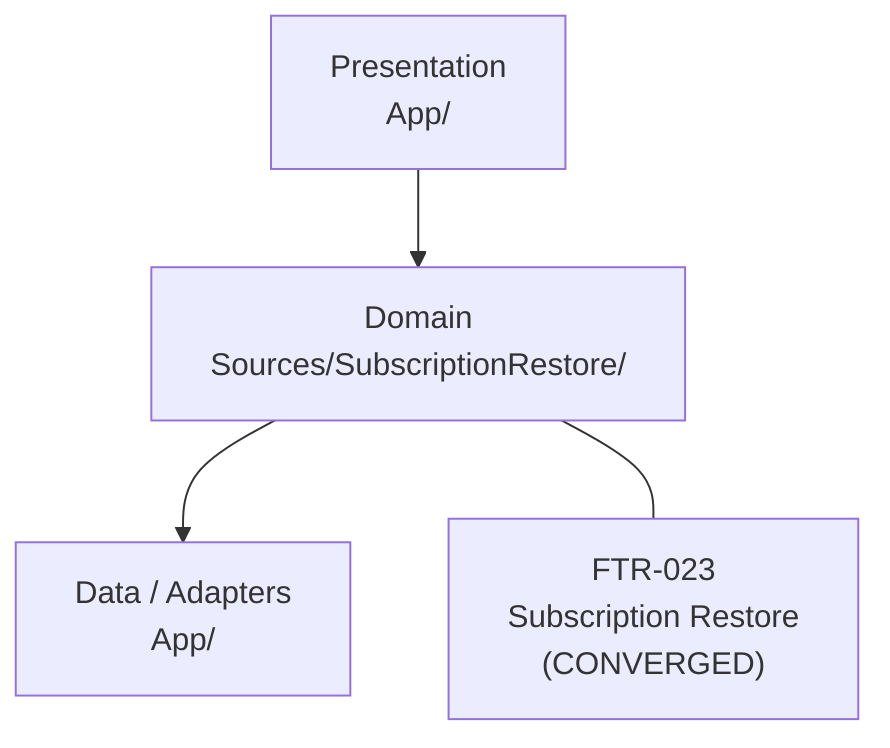
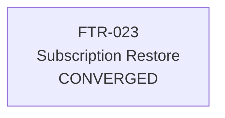

# Subscription Restore sample

iOS 17 SwiftUI app that carries one feature through spec-driven development. The SDD documents in `.sdd/` are the source of truth. This page summarizes them for review.

## Status at a glance

The table below is generated from each feature's `status.yaml` by `make readme`. Do not edit it by hand. CI runs `make readme-check` and fails if it is out of date.

<!-- sdd-report:start -->
| Feature | Status | Requirements verified | Plan items verified | Tasks verified | Tests passing | CI | Release ready |
| --- | --- | --- | --- | --- | --- | --- | --- |
| FTR-023: Subscription Restore | `CONVERGED` | 4 of 4 | 5 of 5 | 8 of 8 | 5 of 5 | `success` | No |
<!-- sdd-report:end -->

### Spec ready vs implemented

Generated by `make readme` from each feature's checklist, clarify, and `status.yaml`. Full copy: [`.sdd/progress.md`](.sdd/progress.md).

<!-- sdd-progress:start -->

### Summary

| Metric | Count | Progress |
| --- | ---: | --- |
| Features | 1 | |
| Spec ready | 1 | ██████████ 100% |
| Spec implemented | 1 | ██████████ 100% |
| Verified / converged | 1 | ██████████ 100% |
| Release ready | 0 | ░░░░░░░░░░ 0% |

### Feature board

| Feature | Spec ready | Spec → code | Verified | Tests | Status | CI | Blocking |
| --- | --- | --- | --- | --- | --- | --- | --- |
| [FTR-023](.sdd/features/FTR-023-subscription-restore/spec.md) FTR-023: Subscription Restore | Yes (`13/13` checklist) | ██████████ 100% | ██████████ 100% | ██████████ 100% | `CONVERGED` | `success` | — |

<!-- sdd-progress:end -->

### Architecture and feature map

Generated by `make readme` from [`.sdd/feature-map.yaml`](.sdd/feature-map.yaml). Full copy: [`.sdd/feature-map.md`](.sdd/feature-map.md).

<!-- sdd-feature-map:start -->

### Layer map



### Feature dependency graph



### Feature correlation table

| Feature | Status | Primary layer | Modules | Depends on | Related to | Provides | Consumes | Progress |
| --- | --- | --- | --- | --- | --- | --- | --- | --- |
| [FTR-023](.sdd/features/FTR-023-subscription-restore/spec.md) Subscription Restore | `CONVERGED` | `domain` | `RestorePurchasesView`, `SubscriptionViewModel`, `SubscriptionRepository`, `EntitlementMapping`, `StoreKitRestoreAdapter` | — | — | subscription-access | — | req 4/4; plan 5/5 |

<!-- sdd-feature-map:end -->

Current CI: [Sample iOS app workflow](https://github.com/viral7chauhan/AgentSkills/actions/workflows/sample-ios-app.yml)

`CONVERGED` means every requirement traces to a plan item, a task, a passing test, and a green CI run. It does not mean the feature can ship. The open items are listed under [Before release](#before-release).

Branch: `sample/subscription-restore`. It is not merged to `main`, and no pull request is open yet.

## What the feature does

After a reinstall, a subscriber taps Restore Purchases and gets access back without paying again. Restore never starts a purchase.

| Requirement | Rule | Test | Result |
| --- | --- | --- | --- |
| FR-023-001 | An active subscription unlocks content and does not start a purchase | TC-023-001, TC-023-004, TC-023-005 | Pass |
| FR-023-002 | A pending transaction with no active subscription shows "Purchase pending" and stays locked | TC-023-002, TC-023-005 | Pass |
| FR-023-003 | No network shows the offline message, stays locked, and does not retry | TC-023-003 | Pass |
| NFR-023-001 | Restore rules are testable without a live App Store | TC-023-001 | Pass |

Out of scope: a paywall or new purchase, Family Sharing, offers, and translation.

## Decisions already made

| ID | Question | Decision |
| --- | --- | --- |
| Q-001 | Pending with no active subscription | Show "Purchase pending". Keep content locked. |
| Q-002 | Network down during restore | Fail now. No retry queue. Keep content locked. |
| Q-003 | Restore finds nothing | Show "No active subscription found." Do not start a purchase. |
| Q-004 | Active subscription and pending transaction both exist | Active wins. Content unlocks. |
| ADR-001 | Where StoreKit is allowed | Only in `App/StoreKitRestoreAdapter.swift`, behind the `SubscriptionRestoring` protocol |

## Plan progress

Plan version 2 is approved. Version 2 moved the tests from XCTest to Swift Testing.

| Plan item | Work | Status |
| --- | --- | --- |
| P-023-001 | Restore protocol and repository | Verified |
| P-023-002 | Map store state to inactive, pending, or active | Verified |
| P-023-003 | View model copy and unlock rules | Verified |
| P-023-004 | StoreKit adapter | Verified by build and mapping tests. Not run against a live store |
| P-023-005 | Restore Purchases screen | Verified by build and view-model tests. No UI test |

## Evidence

| Check | Result |
| --- | --- |
| `swift test` | 10 Swift Testing tests in 3 suites passed |
| Xcode Run and Test | Passed on a simulator, run manually |
| GitHub Actions [run 37343683468](https://github.com/viral7chauhan/AgentSkills/actions/runs/37343683468) | First green run, recorded as convergence evidence: artifact check, `swift test`, `xcodebuild test` |
| Pull requests (and pushes to `main`) | CI runs `make validate`, `make status-check`, `make readme-check`, and `swift test`, then `make test` (the Xcode test on a simulator) and `make ci-gate`. The gate fails CI if any FTR-023 test case did not pass in that run. See the [workflow history](https://github.com/viral7chauhan/AgentSkills/actions/workflows/sample-ios-app.yml) |

## Before release

| Item | Owner | Status |
| --- | --- | --- |
| Restore against a StoreKit sandbox account | iOS team | Not started |
| UI test for the Restore Purchases screen | iOS team | Not planned in this sample |
| SwiftLint or SwiftFormat in CI | iOS team | Not configured |
| Code review and merge to `main` | Team lead | No pull request yet |
| Release notes and rollout plan | Team lead | Not started |

## How to check progress yourself

| Question | Where to look |
| --- | --- |
| Is the feature done? | `.sdd/features/FTR-023-subscription-restore/status.yaml` |
| Is the spec ready / implemented? | [`.sdd/progress.md`](.sdd/progress.md) (also on this README) |
| How do features relate? | [`.sdd/feature-map.md`](.sdd/feature-map.md) (also on this README) |
| What proves each plan item? | `.sdd/features/FTR-023-subscription-restore/execution.yaml` |
| Does every requirement have a test? | `.sdd/traceability.yaml` |
| What is the agreed behavior? | `.sdd/features/FTR-023-subscription-restore/spec.md` and `clarify.md` |
| Did someone change the plan without review? | `make plan-change` |
| Is CI green? | [Sample iOS app workflow](https://github.com/viral7chauhan/AgentSkills/actions/workflows/sample-ios-app.yml) |

From `sample-ios-app/`:

```bash
make validate                          # structure, traceability, and execution evidence for all features
make execution-check                   # every plan item VERIFIED with all evidence true
make execution-check FEATURE=FTR-023   # the same check for one feature
make report                            # one status line per feature
make status                            # regenerate status.yaml counts and traceability.yaml
make progress                          # regenerate .sdd/progress.md
make feature-map                       # regenerate .sdd/feature-map.md
make readme                            # regenerate status table, progress board, and feature map above
make plan-change                       # has any plan.md changed since it was approved?
make plan-change FEATURE=FTR-023       # the same check for one feature
make unit-test                         # swift test (fast, no simulator)
make test                              # Xcode test on a simulator, as declared in .sdd/project/build.yaml
make ci-gate                           # is every claimed feature's test case passing in that run?
make ci                                # everything CI runs, in order
```

`make validate` and the other SDD targets check the documents. `make test` builds and tests the app, and `make ci-gate` ties the two together: a feature counts as verified only when every test case in its test plan passed in CI.

The counts in `status.yaml` and all of `.sdd/traceability.yaml` are generated. Edit only the source files (`spec.md`, `plan.md`, task states in `tasks.md`, results in `test-plan.md`, evidence in `execution.yaml`), then run `make readme` and commit everything it changed. Add CI runs to `ci_runs` in `traceability.yaml` by hand.

If the plan check prints `PLAN_CHANGED`, the earlier evidence is stale. Choose implement, validate, or review before treating the feature as converged again.

## Run the app

Open `SubscriptionRestore.xcodeproj` in Xcode and use Run or Test. Signing is off, so a simulator build does not need a team. Turn signing on before installing on a device.

CI is defined in `.github/workflows/sample-ios-app.yml`. It runs on pull requests, and on pushes to `main`, when `sample-ios-app/` or the SDD scripts it uses change. The quick checks job runs first; the simulator job runs after it passes. Feature-branch pushes without a PR do not start a second copy of the same jobs.
